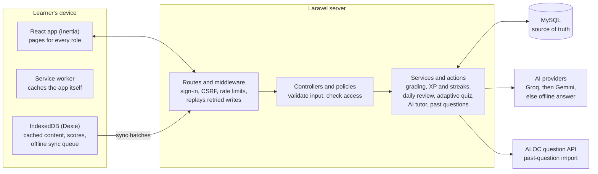

# 🧠 AceDrill — Offline-First Practice and Revision for Nigerian Schools

> **Learners drill questions from their own class, the app schedules what they should review each day, and an AI tutor explains mistakes. It keeps working with no internet and syncs when the connection returns.**

---

## 💡 Why AceDrill?

### The problem
1. **Cram and forget**: students study for a test and forget most of it within a week.
2. **Practice tests only give a score**: "12/20, failed" doesn't fix the mistake.
3. **Overworked classrooms**: a teacher with 50 learners can't personalise homework for each one.
4. **Data costs**: expensive, patchy internet makes online learning hard.

### How AceDrill solves it
* **Five minutes a day**: a daily review of 6 questions, picked by a spaced repetition schedule so learners revise just before they forget.
* **Built on the school's own curriculum**: questions come from the learner's class, programme (Science, Business, Arts) and subjects.
* **AI tutor**: explains why an answer is right or wrong, step by step, with a built-in offline tutor when there's no internet.
* **Offline-first**: content, quizzes and the review queue live on the device; work syncs when the connection returns.
* **School CBT exams**: teachers set timed computer-based tests (CA tests, mid-terms, mock exams) from the school's own question bank, run the room live, and release results. The server marks every paper.
* **Recess**: finishing a quiz, flashcard deck or daily review earns a 10-minute game break (Word Search, Make 24, Connect 4, Word of the Day). The games run on the device, so they work offline too.

---

## 👥 Who uses it

| Role | What they do in the app |
| :--- | :--- |
| **Learner** | Takes quizzes and adaptive quizzes, sits school CBT exams, does the daily review, practises WAEC/JAMB/NECO past questions, chats with the AI tutor, earns XP and badges |
| **Teacher** | Sees their classes, finds struggling learners and weak topics, writes and imports questions, uses the AI to draft questions and lesson ideas, sets and invigilates school CBT exams |
| **School admin** | Manages one school: its classes, teachers, learners, subjects and question bank; switches School CBT and Recess on or off |
| **Platform admin** | Manages every school, shared content, past questions and feedback |

A school is set up with the levels it teaches (primary, junior, senior or a mix). Its classes hold subjects, subjects hold topics, topics hold questions. Every answer a learner gives updates three things: their mastery of that topic, their review schedule, and their XP and streak. Teachers see the same numbers, rolled up by class.

---

## 🏗️ The big picture

AceDrill is one Laravel app that serves a React front end, plus an offline copy of that front end on the learner's device. The device can run on its own; the server is where everything is checked, calculated and stored.



| Layer | Technology |
| :--- | :--- |
| **Server** | PHP and Laravel, MySQL in production (SQLite for fast tests) |
| **Web front end** | React, TypeScript, Inertia.js, Tailwind CSS, KaTeX for maths |
| **Offline** | Dexie (IndexedDB) for data, Workbox service worker (vite-plugin-pwa) for the app shell |
| **AI** | Groq and Google Gemini, with rule-based offline fallbacks |
| **Time** | All days and streaks use Lagos time (`APP_TIMEZONE=Africa/Lagos`) |

---

## 🏫 Schools, content and who sees what

Every school's people and content are walled off from other schools; only shared content (with no school) is visible to everyone. This is enforced on the server for every request, not just hidden in the screens.

**How content is organised**

1. **School**, with the levels it teaches in `category_ids`: `1` Primary (Creche to Primary 6), `2` Junior Secondary (JSS1–3), `3` Senior Secondary (SS1–3), or any mix. A school saved without categories is treated as senior secondary.
2. **Programme** (Science, Business, Arts) and **class** (for example SS1 Science), at a grade the school allows.
3. **Subject**, belonging to a class.
4. **Topic**, belonging to a subject and a level.
5. **Question** with its options, optionally sharing a passage, poem or diagram with other questions. Questions are grouped into **quizzes**.

Learners and teachers join classes through memberships; a learner's class and programme decide which subjects, quizzes and review questions they get.

| Role | Sees | Can change |
| :--- | :--- | :--- |
| Learner | Active content of their school and grade, plus shared content | Only their own attempts, reviews and profile |
| Teacher | Their school's content; learner data only for their own classes | Questions and quizzes they may author; their classes' enrolments |
| School admin | Everything in their school | Their school's classes, people, subjects and questions |
| Platform admin | All schools | Everything, including shared content and past questions |

**How it is enforced**

- **Query scopes** (`forUser`, `visibleTo`) filter every list to the user's school and allowed grades.
- **Policies** (`app/Policies/`) answer "may this user do this to this record?". For quizzes: a learner may view an active quiz of their school or a shared one; an admin of that school may also see inactive ones; an offline attempt is accepted even if the quiz was switched off after the learner took it.
- Deleting a school that still has content is refused with a count of what is in use, so its private content can't leak into the shared pool.
- A deactivated account, or a school admin with no school, is signed out on the next request.

---

## 🔁 How a request moves through the backend

Every page and every JSON endpoint lives in `routes/web.php` and uses the browser's signed-in session; `routes/api.php` is empty on purpose. A request passes the same checks in the same order whether it comes from a click or from the offline sync queue.

**The path of one request** (for example, a learner submitting a quiz):

1. **Route** matches the URL to a controller method (`QuizWebController@submitQuizAttempt`).
2. **Middleware**, in order:
    - **Forgery check**: a write must come from the app's own pages (same-origin browser header) or carry the CSRF token.
    - **Account check** (`EnsureAccountIsActive`): a deactivated user, or a school admin with no school, is signed out.
    - **Shared page data** (`HandleInertiaRequests`): the signed-in user, their school and allowed grades for React pages.
    - **Idempotency** (`EnsureIdempotentRequest`): a write with an `Idempotency-Key` header runs once; a retry with the same key gets the stored response, so a lost reply never creates duplicates.
    - **Sign-in and role gates**: `auth`, then `can:access-teaching`, `can:access-admin` or `can:manage-platform` on the groups that need them.
    - **Rate limits**: per user for the API and the AI, and per email and IP for sign-in.
3. **Form request** validates the input (`app/Http/Requests/`) and returns 422 with field errors if it's wrong.
4. **Controller** checks the policy for this record, then hands the work to an action or service.
5. **Actions and services** do the real work: `GradeQuizAttempt`, `GamificationService`, `SpacedRepetitionService`, `AdaptiveService`, `AIService`. Writes that belong together run in one database transaction.
6. **Models** (Eloquent, `app/Models/`) read and write MySQL, using scopes like `forUser` to stay inside the user's school.
7. **Response**: a React page through Inertia for page loads, or JSON for API calls. Errors on API routes are always JSON and never include SQL or stack traces.

| Folder | Holds |
| :--- | :--- |
| `routes/web.php` | Every URL and its middleware |
| `app/Http/Controllers/Web`, `Admin`, `Api`, `Auth` | Learner/teacher screens, admin screens, public past questions, sign-in |
| `app/Http/Requests` | Input validation |
| `app/Policies` | Who may do what to which record |
| `app/Actions`, `app/Services` | Grading, XP, reviews, adaptive quizzes, AI, past-question import |
| `app/Models` | Database tables and their relationships |
| `app/Support` | Small shared helpers (search terms, page sizes, maths text) |

Maintenance tasks for hosts without SSH are protected and switched off by default. See [DEPLOY_GUIDE.md](DEPLOY_GUIDE.md).

---

## 📝 Quizzes, grading and topic mastery

The server grades every quiz itself; the score a device reports is never trusted. The same grader (`app/Actions/Quiz/GradeQuizAttempt.php`) handles an online submit and an offline attempt that syncs later, so the two can't disagree.

**What happens when a learner submits a quiz**

1. The server loads the quiz's active questions with their options and marks.
2. Each answer is graded:
    - single answer: right if the chosen option is marked correct;
    - several correct options: right only if the learner picked exactly the correct set;
    - an option id that belongs to another question, or no longer exists, is stored as "no answer".
3. Score = the sum of marks for right answers; total = the sum of all marks (1 per question unless the quiz sets more). A wrong or skipped answer scores 0; there is no negative marking and no part marks.
4. In one database transaction: the attempt, every answer and the topic progress are saved together.
5. XP, streak and badges are awarded once for that attempt.
6. Every answered question gets or updates its review card.

$$\text{Percentage} = \text{round}\left(\frac{\text{score}}{\text{total marks}} \times 100\right)$$

**Topic mastery.** Each learner has one progress row per topic with questions attempted, questions correct and a mastery score. Each activity adds to the counts, and mastery is recomputed from the new totals:

$$\text{Mastery} = \text{round}\left(\frac{\text{correct}_{old} + \text{correct}_{new}}{\text{attempted}_{old} + \text{attempted}_{new}} \times 100\right)$$

Example: 6 of 10 right before, then 4 of 5 in a new quiz → 10 ÷ 15 = **67%**. The update is a single database statement (`LearnerProgress::recordResults`), so two syncs arriving at once never lose a count. "Last attempted" only ever moves forward, so an old offline attempt synced late can't make a topic look stale.

**What mastery is used for**

- Under 75% → a weak topic, used to pick new daily review questions. Teachers see each topic as critical (under 50%), moderate (50–74%) or mastered (75% and up); admin dashboards flag a learner whose average mastery is under 40% as struggling.
- It sets the starting difficulty of an adaptive quiz.
- Subject mastery badges (50%, 80%, 100%) are earned from it.

---

## 🎯 Adaptive quizzes

An adaptive quiz picks each next question to match how well the learner is doing, like a chess rating. It runs for 10 questions (fewer if the quiz has fewer). Code: `app/Services/Adaptive/AdaptiveService.php`.

**The ability score.** Every learner starts between 800 and 2200, based on their average mastery of the quiz's topics; with no history they start at 1500. It is kept between 500 and 2500. Questions are rated by difficulty: easy 1000, medium 1500, hard 2000.

$$\text{Start} = \text{round}\left(800 + \frac{\text{avg mastery}}{100} \times 1400\right)$$

**After each answer** the score moves by the Elo formula with K = 32, where $E$ is the chance the learner was expected to get it right and $S$ is 1 if right, 0 if wrong:

$$E = \frac{1}{1 + 10^{(R_q - A)/400}} \qquad A' = A + 32 \times (S - E)$$

| Learner at 1500 answers | Expected chance | Result | New ability |
| :--- | :--- | :--- | :--- |
| a medium question (1500) | 50% | right | 1516 |
| a hard question (2000) | 5% | right | 1530 |
| an easy question (1000) | 95% | wrong | 1469 |

**Choosing the next question.** Each unanswered active question gets a closeness score, 1 ÷ (1 + distance ÷ 400), where distance is the gap between its rating and the learner's ability. A small random factor is added so questions of the same difficulty don't always come in the same order; the highest score wins.

**Labels shown to the learner:** Beginner (under 1200), Developing (1200–1499), Proficient (1500–1799), Advanced (1800–2099), Expert (2100 and up).

---

## ⚡ Spaced repetition: the daily review

Each question a learner has seen gets a review card with a next-review date. Right answers push the date further out; a mistake brings it back to tomorrow. This is a version of the SuperMemo SM-2 method. Code: `app/Services/SpacedRepetition/SpacedRepetitionService.php`.

**First time a question is seen:** right → next review in 3 days ("fragile mastery"); wrong → tomorrow ("recent mistake"). Every card starts with an ease factor of 2.50.

**Every later review**

1. Wrong, or rated "again" → interval back to 1 day, ease − 0.20, run of correct answers back to 0.
2. Right → ease + 0.15 if rated "easy", − 0.15 if "hard", unchanged if "good". Then the next interval: 3 → 7 → 14 days for the first steps; after that, the previous interval × a multiplier.
3. Five right answers in a row, or an interval of 60 days or more → the card is **mastered**. It returns after at least 60 days as a retention check.

$$EF' = \max(1.30,\ \min(3.00,\ EF + \Delta)) \qquad \Delta = -0.20 \text{ (wrong)},\ -0.15 \text{ (hard)},\ 0 \text{ (good)},\ +0.15 \text{ (easy)}$$

$$I_{next} = \min(365,\ \text{round}(I_{prev} \times m)) \qquad m = EF \text{ (good)},\ \max(EF, 2.5) \text{ (easy)},\ 1.2 \text{ (hard)}$$

The 365-day cap exists because unlimited "easy" growth pushed dates past 2038, which MySQL `TIMESTAMP` cannot store.

| Review | Result (always "good") | Next review in | Status |
| :--- | :--- | :--- | :--- |
| 1st sight | right | 3 days | active |
| 2 | right | 7 days | active |
| 3 | right | 14 days | active |
| 4 | right | 35 days (14 × 2.5) | active |
| 5 | right | 88 days (35 × 2.5) | mastered |
| 6 | wrong | 1 day | active again, ease 2.30 |

**Building today's queue (6 cards)**

1. Cards due today or overdue, from the learner's own class and programme subjects, including mastered cards due for their retention check.
2. Ordered by reason: recent mistakes first, then fragile mastery, then weak topics, then the oldest due date.
3. Fewer than 6 due → new questions are added, in this order: the learner's 5 weakest topics (mastery under 75%), then their exact class, then other classes in their programme. Questions the learner already has a card for are never re-added.

Reviews done offline are scheduled from the time they actually happened, not the time they synced.

---

## 🎮 Gamification: XP, levels, streaks, badges

Every activity earns XP, XP sets the level, and showing up on consecutive days builds a streak. The server computes all of it; the device only reports what happened. Code: `app/Services/Gamification/`.

| Activity | XP | Daily cap |
| :--- | :--- | :--- |
| Finish a quiz | 5 | none |
| Each correct quiz answer | 1 | none |
| Perfect quiz score (all correct) | +3 | none |
| First time finishing that quiz | +2 | none |
| Flashcard deck: per card rated easy / good / again | 2 / 1 / 0, plus 5 for finishing the deck | 75 per day |
| Daily review: per correct answer, +3 if all correct | 1 each | 30 per day |
| Streak milestone every 7 days | 5 × (streak ÷ 7): 5 at day 7, 10 at day 14 | none |
| Badge earned | 5 or 10, per badge | none |
| Streak broken with no shield | −15 (never below 0) | n/a |

The caps exist because flashcard ratings and review counts come from the device, which the server cannot re-check. A quiz's XP is awarded exactly once, even when the online submit and an offline sync of the same attempt arrive together.

**Worked example.** A learner's first try at a 10-question quiz, 10 correct: 5 + 10 + 3 + 2 = **20 XP**.

**Levels** (`Levels::THRESHOLDS`): the level is the highest threshold the learner's total XP has reached.

| Level | XP needed | Tier |
| :--- | :--- | :--- |
| 1 | 0 | Newcomer |
| 2 | 100 | Newcomer |
| 3 | 250 | Learner |
| 4 | 500 | Learner |
| 5 | 800 | Scholar |
| 6 | 1,200 | Scholar |
| 7 | 1,700 | Achiever |
| 8 | 2,300 | Achiever |
| 9 | 3,000 | Expert |
| 10 | 4,000 | Expert |
| 11 | 5,200 | Master |
| 12 | 6,600 | Master |
| 13 | 8,200 | Champion |
| 14 | 10,000 | Champion |
| 15 | 12,500 | Legend |

**Streaks**, compared by calendar day in Lagos time:

- Active again the next day → streak + 1. Same day → no change.
- Missed exactly one day while holding a shield → the shield is used and the streak continues.
- Otherwise → streak resets to 1 and the learner loses 15 XP.
- Shields (Streak Freeze) are earned at 7, 14 and 30 days; a learner holds at most 2.
- Offline activity counts for the day it happened; activity that syncs late never breaks a streak.

**Badges.** 20 achievements, checked after each activity: quizzes completed (1, 5, 10, 25), perfect scores (1, 3), streaks (3, 7, 14, 30 days), subject mastery (50%, 80%, 100% in any subject; 80% in all of the learner's subjects), level 5 and 10, total XP 1,000 and 5,000, a quiz finished in under 2 minutes, and trying a quiz in every subject.

**Leaderboard.** The top 10 by total XP, cached for 5 minutes. A learner's own position = 1 + the number of learners with more XP, so ties share a place.

---

## 🤖 The AI layer

The AI never blocks the app: every AI feature has an offline answer that is used when no provider replies in time. `app/Services/AIService.php` decides what to ask; `app/Services/AI/AiClient.php` talks to the providers.

| Feature | Who | Offline answer when AI is unavailable |
| :--- | :--- | :--- |
| Explain why an answer is right or wrong | Learner | Rule-based explanation from the question and its options (`OfflineExplainer`) |
| Tutor chat (study companion) | Learner | Rule-based tutor that sets practice questions and grades them (`OfflineTutor`) |
| Copilot chat (class insights, lesson ideas) | Teacher, admin | Summary built from the school's data |
| Extract questions from pasted text and solve them | Teacher, admin | Text parser that splits questions and options |
| Generate questions for a topic | Teacher, admin | Template questions, flagged "needs review" |

**Provider chain.** Groq is tried first (main model, then a fallback model with its own rate limits), then Google Gemini (main, then fallback). `AI_PROVIDER=gemini` reverses the order; `local` skips the AI entirely.

- The whole chain shares a **20-second budget** (`AI_TIME_BUDGET`), so a slow provider still leaves time for the offline answer before the PHP time limit.
- A model that returns 429 (rate limited) is set aside for its Retry-After time (60 s if not given, 5–600 s), so the next requests skip straight to the next model.
- Failures are logged as `ai.provider_failed` with provider, model and status, never the key.

**Explanations are written once and reused.** An explanation depends only on the question, its version and the option chosen, not on the learner, so the AI writes each one once:

1. The cache is checked first (30 days).
2. If it isn't there, the saved explanation in `ai_explanations` is used and put back in the cache.
3. Only when neither has it does the AI answer. The answer is saved to the table and the cache.

So clearing the cache, or a deploy, never means paying for the same explanation again. Only real AI answers are saved; an offline answer is cached for 10 minutes so the AI gets another try soon. A lock makes 30 learners asking at once produce one AI call. Editing the question changes its version, so a fresh explanation is written. A question with no correct option marked returns "Answer key missing" instead of a made-up explanation. The saved explanations can later be shipped in the offline download or used to fine-tune a model.

**A person checks the AI.** Every AI explanation says whether a teacher has checked it ("Checked by a teacher", or "Written by AI · it can make mistakes"), and anyone signed in can report one as wrong, confusing or not suitable, once per version. Reported explanations appear at the top of the Question Bank for the staff who manage that question (its school's admins and the teachers of its class; platform admins for shared and past questions), who approve it, correct it by hand or from a fresh AI draft, or hide it. Three reports hide an unchecked explanation until someone reviews it, and learners get the offline explanation meanwhile; a checked one goes back to the queue but stays up. Questions the AI drafts for the question bank are never saved until a teacher reviews them either.

**Usage is metered.** Every reply a provider bills for, including one cut off at the token limit, adds its input and output tokens to `ai_usage_daily`: one row per day, feature and model. The features are `explain_question`, `explain_past_question`, `learner_chat`, `staff_chat`, `question_import` and `question_generation`. Recording never blocks an answer; a failure is only logged.

```bash
php artisan ai:usage --days=30
```

shows requests and tokens per feature and model, and how many explanations are saved.

**Chat is kept lean**, because it is the one AI cost that grows with every learner:

- **The fixed part of the prompt comes first** (persona, rules, guidelines), identical on every message, so providers can reuse their cached copy. The learner's own details come last.
- **Only what the tutor needs:** the learner's 5 weakest topics, not every topic. The teacher copilot gets the school's numbers, but no longer 5 random sample questions on every message.
- **The last 6 turns of history** are sent, not all 20.
- **Learner replies are capped at 700 tokens** (thinking included); the prompt asks for under 150 words anyway. The teacher copilot keeps 1,500 for lesson plans and question drafts.
- **A daily cap per user:** 40 AI chat messages for learners (`AI_DAILY_CHAT_LIMIT`) and 150 for staff (`AI_DAILY_STAFF_CHAT_LIMIT`), reset at midnight; 0 turns it off. Past the cap, learners get the built-in offline tutor with a note saying why, never an error.

**Chats are saved for their owner.** Each chat is kept in `ai_conversations` and `ai_messages`, so a learner can open **History** in the chat panel and reread yesterday's answer instead of asking (and paying) again. The last chat reopens when the panel opens. Only the owner can list, open or delete their chats; anyone else gets a 404. When a saved chat continues, the AI gets its recent turns from the server's copy, so a client can't slip invented earlier replies into the prompt. Chats unused for a year are deleted by the daily `model:prune` schedule, and all of a user's chats go when their account is deleted.

**Safety and privacy**

- Each user can make 20 AI requests a minute.
- Learner input is screened for prompt-injection patterns before it reaches the model.
- Chat history is limited to 20 messages of up to 2,000 characters each, and only the last 6 are sent to the AI.
- The learner tutor knows the learner by first name only.
- The teacher copilot only sees learners in the teacher's own classes, and only gets the roster when the question is about students.

---

## 🔌 Offline and sync

The device keeps a copy of what the learner needs and a queue of what they did; when the connection returns, the queue is sent and the server re-checks everything. The server stays the source of truth: anything the device shows is a cache.

**What lives on the device** (`resources/js/db/database.ts`): subjects, topics, quizzes, flashcards, quiz attempts, topic progress, XP profile, the user's profile, page snapshots for offline viewing, admin lists for staff, and the sync queue. The service worker caches the app itself so it opens with no network.

**Recess games are fully offline.** Word Search, Make 24, Connect 4 and Word of the Day run in the browser with no server call; Word Search and Word of the Day draw their words from the subjects already saved on the device. Earned breaks and the running countdown are kept in the browser per user, and `/recess` opens offline like the other learner pages. A win made offline joins the sync queue; the server pays 5 XP for the first win of the day only (whichever game, however many are played), and only if the learner also studied that day; and a school that has switched Recess off gets nothing.

**What happens to something done offline**

1. The action is applied on the device at once and added to the sync queue (`resources/js/services/SyncQueue.ts`) with the time it happened.
2. Back online, the queue sends its items in batches to the server's sync endpoint, oldest first.
3. The server runs each item through the same endpoint and rules as an online request: same permissions, same grader, same XP rules.
4. Results come back per item:
    - success → removed from the queue; a temporary id is swapped for the server's id;
    - sign-in expired, rate limited, server error or "already in progress" → the batch stops there and retries later with exponential backoff, keeping order;
    - rejected (a permission or validation error) → set aside for the user to fix or discard, so it never blocks the rest.
5. Each batch is kept short and only allows a fixed list of paths (quiz attempts, progress, reviews, flashcards, past-question simulations, Recess wins and admin edits).

**Why offline results stay honest**

- A synced quiz attempt is graded again on the server; the device's score is ignored.
- XP for an attempt is claimed once, so the online submit and a sync of the same attempt never pay twice.
- Topic progress from the device is display-only; the server keeps its own counts.
- Offline activity counts for the day it happened, for streaks and review dates.
- Each queue belongs to one user, so a shared family phone never sends one child's work as another's.

---

## 📚 Past questions and CBT practice

About 4,000 real WAEC, JAMB and NECO questions sit in a shared bank that any learner can practise, singly or as a timed exam simulation. Code: `app/Services/PastQuestions/AlocImportService.php` and `app/Http/Controllers/Api/PastQuestionController.php`.

**Getting questions in.** They are imported from the ALOC question API, then shipped with the app as a snapshot that the seeder restores, so a fresh install doesn't need the API.

- Each question is imported in its own transaction, so a failure never leaves a question without its options.
- Duplicates are found by a content fingerprint (a hash that ignores spacing and formatting), stored in a unique column.
- A question with no correct option is saved as a draft for review, never published.
- Each question is matched to a curriculum topic: the source's own topic if given, then an existing topic name, then subject keyword rules, else a general topic.
- The importer remembers where it stopped per exam and subject, so a long import can resume.

**Practice modes**

- **Single questions**: filter by exam, subject, year and topic; check an answer; ask the AI to explain it; see similar questions.
- **Exam simulation (CBT)**: a timed paper, 40 minutes by default, with a countdown, flags and a calculator. It can start and finish offline.

$$\text{Score \%} = \text{round}\left(\frac{\text{correct}}{\text{questions}} \times 100\right)$$

The result breaks down accuracy per topic: **strong** at 70% or more, **moderate** at 40–69%, **weak** under 40%. Topics under 60% are listed as "work on these next". Each topic's results are added to the learner's topic mastery, the same way as a school quiz. Submitting the same simulation twice never counts its answers twice.

---

## 🏫 School CBT exams

Schools set their own computer-based tests and learners sit them in school, on their own phones or the lab's computers. Code: `app/Services/SchoolExams/SchoolExamService.php`, `app/Http/Controllers/Web/SchoolExamController.php` (staff) and `app/Http/Controllers/Web/LearnerExamController.php` (learners).

**Setting an exam (teacher or school admin)**

- Pick the class(es), subject, duration, open and close times, pass mark, and whether learners see their score straight away.
- Add questions from the school's bank: search and hand-pick, or **Add random** to draw a set. Each question can carry its own marks (1–20); the builder shows the running total. Up to 200 questions.
- Publishing gives the exam a 6-character **start code** (no look-alike letters such as O/0 or I/1). Learners can't start without it, so the code is only read out in the room.
- Once anyone has started, only the title, instructions, close time and score visibility can change. The paper itself is locked.

**Who can do what**

| | Can |
|---|---|
| School admin | Set, run and release any exam in their school |
| Teacher | Set exams for the classes they teach; run and release exams they set or that are for their classes |
| Learner | See and sit exams for their own class, only while the exam is open and only with the start code |
| School switch | A school admin can turn School CBT off; the menu links and every route then close |

**Sitting an exam**

1. The learner opens **School Exams**, picks the open exam and types the start code.
2. The server builds their own paper: question order and option order are shuffled per learner (questions on the same passage stay together). The paper never contains the answers.
3. The countdown runs from the server's deadline and is kept on the device with an elapsed-time counter, so changing the phone's clock does nothing.
4. Answers save as they go (1.5 seconds after a pick, and at least every 20 seconds). A reload or a dead battery resumes with the right time left.
5. Leaving the exam screen is counted and shown to the teacher.
6. Time up submits the paper. The server allows 30 seconds' grace for a slow network; after that it refuses new answers and closes the attempt itself, even if the learner never comes back.

**Running the room.** The exam page shows every learner in the class: not started, writing, handed in or timed out, with how many they've answered, time left and how often they left the screen. A teacher can **add time** to one learner or **end** their attempt.

**Marking.** Only the server marks, when the paper is handed in or times out.

$$\text{Score} = \sum \text{marks of the questions answered correctly}$$

$$\text{Percentage} = \frac{\text{score}}{\text{total marks}} \times 100 \quad\text{(kept to 2 decimal places)}$$

Every number on the result is in **marks**, so the parts always add up to the whole. Example: five questions worth 5, 4, 4, 3 and 3 marks (19 in total). A learner who gets the 5, 4, 3 and 3 right scores **15 / 19 = 79%**. That is 4 of 5 questions, but the question count is only shown as a line ("You got 4 of 5 questions right"), never used for the percentage. If every question is worth 1 mark the two numbers are the same.

- Wrong or skipped answers score 0; there is no negative marking.
- **Pass or fail** compares the percentage with the exam's pass mark.
- **Topic breakdown**: each topic's marks out of its total marks, so the topic scores add up to the exam score.

**Results**

- The teacher sees the class average, highest, lowest and how many passed; topics from hardest to easiest (by marks, across the class); and every learner's score. **Download CSV** gives the score sheet.
- Results can be **released** only after the exam closes, so nobody passes answers to classmates still writing.
- After release, learners see their corrections and topic breakdown, and every question they got wrong or skipped joins their daily review (a queued job, `RecordSchoolExamReview`).
- Before release, a learner sees their score only if the teacher chose "show score straight away".

**Kept fast for a whole school.** Indexed on school, status and open time; the exam keeps its question count and total marks so lists don't re-count them; the room view is one query; the question bank is paginated; closing overdue attempts works in batches of 100.

**Coming next.** Sitting an exam with no internet: an encrypted exam pack downloaded ahead of time, unlocked by the start code, with each learner's answers handed to the invigilator's phone by QR code.

---

## 🔏 Terms, privacy and consent

Most learners are children, so AceDrill follows the Nigeria Data Protection Act 2023 model where **the school is the data controller** and collects consent from each learner's parent or guardian. The text of the Terms of Use, Privacy Policy and learner summary lives in `resources/legal/*.md`, so it can change without code changes; `/terms` and `/privacy` show it to anyone.

**Every consent is a row in `consents`, never edited:** who, which document, which version, yes or no, whether they gave it themselves or the school recorded it (and which staff member), and when. The newest row per person and document is the current answer; the rest is the proof.

| Document | Who answers | Where |
| --- | --- | --- |
| `terms`: Terms of Use and Privacy Policy | Staff and independent learners agree; school learners acknowledge a short summary | The agree screen at `/consent`, or the sign-up form |
| `parental`: Part A of the parental consent form | The school, from the signed form | Admin › Learners: one learner's **Consent form**, or tick several (or Select all) and **Record consent forms** |
| `ai_training`: using de-identified data to improve AceDrill's AI | School learners: the school, from Part B of the form. Everyone else: themselves | Admin › Learners, or the Profile page |

- **No answer means no** for AI improvement (`User::allowsAiTraining()`). Any training must use only people whose current answer is yes, with identifying details removed.
- **The agree screen is off until the documents are final** (`LEGAL_REQUIRE_ACCEPTANCE=false`). Once on, page visits by anyone who hasn't agreed to the current `LEGAL_VERSION` go to `/consent`; background calls such as offline sync are never stopped. Changing `LEGAL_VERSION` asks everyone again.
- Only a changed answer adds a row, so saving the same choice twice leaves no noise.
- A bulk save reads every learner's current answers in one query and writes every change in one insert (up to 500 learners). One learner from another school refuses the whole save. Part B starts unticked for a group, because it is each family's own choice.

---

## 🗣️ Explaining it in two minutes

1. **The problem.** Students cram for tests and forget most of it within a week. Practice apps give a score but don't fix the mistake. Teachers can't personalise work for 50 children. Data is expensive.
2. **What AceDrill does.** It's a practice app built on each school's own curriculum: the learner's class, subjects and topics.
3. **Every answer teaches the app something.** It tracks how well the learner knows each topic, as a percentage.
4. **Five minutes a day.** Each day it picks 6 questions: the ones they got wrong recently, the ones they're about to forget, and their weakest topics. Questions they keep getting right come back less and less often: after 3 days, then a week, then two weeks, then months.
5. **It adjusts to the learner.** In an adaptive quiz the next question gets harder when they're doing well and easier when they're struggling, like a chess rating.
6. **A tutor that explains.** When they get something wrong, the AI explains why, step by step. With no internet, a built-in tutor still gives an explanation.
7. **It works offline.** Everything they need is on the phone. Their work syncs when they're back online, and the server checks it.
8. **It keeps them coming back.** XP, levels, daily streaks with shields, badges and a leaderboard.
9. **Teachers and schools see it all.** Which learners are struggling, which topics the class is weak in, and real WAEC, JAMB and NECO past questions for exam practice.
10. **Schools run their own CBT exams.** A teacher sets a timed test from the school's question bank, reads out a start code, watches the room live, and gets a marked score sheet the moment time is up.

**One-line version:** AceDrill turns a school's own curriculum into a five-minute daily drill that remembers what each child is about to forget, explains their mistakes, and works without internet.

---

## 🚀 Quick Setup & Installation

```bash
# 1. Clone repo & install PHP dependencies
git clone https://github.com/your-org/offline-ai-learning.git
cd offline-ai-learning
composer install

# 2. Install JavaScript dependencies
npm install

# 3. Environment setup & key generation
cp .env.example .env
php artisan key:generate

# 4. Database migration & sample curriculum seeding
php artisan migrate:fresh --seed

# 5. Build frontend assets
npm run build

# 6. Start server
php artisan serve
```

Visit `http://127.0.0.1:8000` in your browser. For AI features, set `GROQ_API_KEY` and/or `GEMINI_API_KEY` in `.env`; without them the offline answers are used.

---

## ✅ Tests and code style

```bash
composer test          # PHP tests on in-memory SQLite (fast)
composer test:mysql    # the same tests on MySQL, like production (needs a database named offline_ai_learning_test)
composer lint:check    # code style check (Laravel Pint); `composer lint` fixes it
npx vitest run         # frontend tests
```

The **Tests** GitHub workflow runs all of these on every push and pull request. Tests never call real AI providers: any HTTP request a test does not fake fails it.

---

## 📄 License
This project is licensed under the MIT License.
